<!-- ==================== CUSTOM ANIMATED HERO BANNER ==================== -->

 

<!-- ==================== BILINGUAL TYPING ANIMATION ==================== -->

 

<!-- ==================== QUICK ACTION PILLS ==================== -->

---

## 🖥️ System Telemetry & Identity · Sistem Telemetrisi ve Hakkımda

  

 

<table>
  <tr>
    <td width="50%" valign="top">
      <h3>🇬🇧 Executive Profile</h3>
      <ul>
        <li>🎓 <b>Computer Engineering</b> undergraduate at <b>Necmettin Erbakan University</b> (<b>GPA: 3.18 / 4.00</b> — Honor Student).</li>
        <li>🏢 <b>Systems &amp; Network Management Co-Op Engineer</b> at <b>Türksat A.Ş.</b>, operating enterprise domain infrastructures.</li>
        <li>🛡️ Specialized in <b>Active Directory (AD DS), DNS, DHCP, GPO</b>, Role-Based Access Control (<b>RBAC</b>), and Principle of Least Privilege (<b>PoLP</b>) security hardening.</li>
        <li>⚡ Architecting full-stack web, mobile, and AI systems using <b>Next.js, FastAPI, Flutter, C++/Qt, PyTorch, and Supabase/PostgreSQL</b>.</li>
      </ul>
    </td>
    <td width="50%" valign="top">
      <h3>🇹🇷 Mühendislik Özeti</h3>
      <ul>
        <li>🎓 <b>Necmettin Erbakan Üniversitesi</b> Bilgisayar Mühendisliği Lisans öğrencisiyim (<b>GNO: 3,18 / 4,00</b> — Onur Öğrencisi).</li>
        <li>🏢 <b>Türksat A.Ş.</b> Sistem ve Ağ Yönetimi Direktörlüğü bünyesinde kurumsal sistem ve ağ operasyonlarında görev alıyorum.</li>
        <li>🛡️ Kurumsal etki alanı mimarisi (<b>AD DS, DNS, DHCP, GPO</b>), <b>RBAC</b> ve En Az Yetki Prensibi (<b>PoLP</b>) tabanlı altyapı güvenliğine odaklanıyorum.</li>
        <li>⚡ <b>Next.js, FastAPI, Flutter, C++/Qt, PyTorch ve PostgreSQL</b> ile uçtan uca yüksek başarımlı web, mobil ve yapay zekâ çözümleri geliştiriyorum.</li>
      </ul>
    </td>
  </tr>
</table>

---

## 🌌 Featured Engineering Showcase · Öne Çıkan Mühendislik Vitrini

<table>
  <tr>
    <td colspan="2">
      <h3 align="center">✨ <a href="https://yorukokan.github.io/portfolyo/">Interactive 3D WebGL Particle Metamorphosis Portfolio</a> · <a href="https://github.com/yorukokan/portfolyo">[Source Code]</a></h3>
      

        <b>🇬🇧 EN:</b> Zero-dependency <b>WebGL 1.0 + GLSL Shader</b> interactive experience morphing <b>22,000+ real-time particles</b> at 60–120 FPS across 8 choreographed stages (3D Portrait Silhouette → Orbital Sphere → Türkiye Topographic Map → DNA Helix → Wavy Flag-Distorted Project Canvases → Spiral Galaxy Vortex). Utilizes a precomputed <code>Float32Array</code> Sine Lookup Table (<code>SIN_LUT</code>) for <code>&lt;0.4ms</code> frame CPU overhead. 
        <b>🇹🇷 TR:</b> Sıfır harici 3B kütüphane bağımlılığıyla (<b>Saf WebGL 1.0 + GLSL + SIN_LUT</b>) 22.000+ partikülü kaydırma hızına duyarlı olarak 8 farklı sahnede (Portre Silüeti → 3B Küre → Türkiye Haritası → DNA Sarmalı → Dalgalı Proje Kanvasları → Galaksi Girdabı) 60–120 FPS'te dönüştüren interaktif mühendislik portfolyosu.
      

      

        
        
      

    </td>
  </tr>
  <tr>
    <td width="50%" valign="top">
      <h4>📈 <a href="https://github.com/yorukokan/ipo-finance-tracker">IPO Finance Tracker · Halka Arz &amp; Portföy Takip</a></h4>
      

        <b>EN:</b> Production FinTech web platform managing multi-account portfolios, IPO lot allocations, real-time profit distribution, and automated analytics with Row-Level Security (RLS). 
        <b>TR:</b> Çoklu yatırım hesaplarını, halka arz başvurularını, lot tahsislerini ve kâr/zarar analizlerini gerçek zamanlı yöneten canlı FinTech platformu.
      

      

        <code>Next.js 16</code> <code>React 19</code> <code>TypeScript 5</code> <code>Tailwind 4</code> <code>Supabase (PostgreSQL &amp; RLS)</code>
      

      

        
        
      

    </td>
    <td width="50%" valign="top">
      <h4>🧠 <a href="https://github.com/yorukokan/ai-powered-mood-analysis-personalized-nutrition-activity-recommendation">AI Mood &amp; Nutrition Recommender · Duygu Tabanlı Öneri</a></h4>
      

        <b>EN:</b> Hybrid AI mobile ecosystem performing real-time facial emotion recognition via a custom <b>PyTorch CNN</b> model trained on <b>FER-2013</b> to deliver personalized nutrition and activity plans. 
        <b>TR:</b> FER-2013 veri setiyle eğitilen <b>PyTorch CNN</b> modeli ve <b>OpenCV</b> ile anlık yüz duygu analizi yaparak kişiselleştirilmiş besin ve aktivite öneren mobil sistem.
      

      

        <code>Flutter</code> <code>FastAPI</code> <code>PyTorch CNN</code> <code>OpenCV</code> <code>PostgreSQL</code> <code>Firebase Auth</code>
      

      

        
      

    </td>
  </tr>
  <tr>
    <td width="50%" valign="top">
      <h4>📚 <a href="https://github.com/yorukokan/bookan-mobile-app">Bookan — Social Book Ecosystem · Sosyal Kitap Platformu</a></h4>
      

        <b>EN:</b> Cross-platform social reading &amp; library management ecosystem integrating Google Books API, personal reading telemetry, and community quote feeds across Mobile and Web. 
        <b>TR:</b> Google Books API entegrasyonu, kişisel okuma takibi ve topluluk alıntı akışını birleştiren çok platformlu (Mobil &amp; Web) sosyal kitap keşif ekosistemi.
      

      

        <code>Flutter &amp; Dart</code> <code>Cloud Firestore</code> <code>Native PHP 8 (PDO)</code> <code>MySQL</code> <code>Google Books API</code>
      

      

        
        
      

    </td>
    <td width="50%" valign="top">
      <h4>🖥️ <a href="https://github.com/yorukokan/library-management-system-Qt">C++ / Qt Desktop &amp; Systems Suite · Sistem Otomasyonları</a></h4>
      

        <b>EN:</b> Native C++/Qt desktop applications and algorithmic tools featuring relational SQLite adapters, OOP architectures, multithreaded TCP/UDP socket telemetry, and visualizers. 
        <b>TR:</b> İlişkisel SQLite veritabanı mimarisi, C++ OOP, Qt Widgets arayüzleri, çok iş parçacıklı TCP/UDP soket haberleşmesi ve algoritma görselleştirme araçları.
      

      

        <code>C++</code> <code>Qt Widgets</code> <code>SQLite</code> <code>Python Sockets (TCP/UDP)</code> <code>Algorithms</code>
      

      

        
        
        
      

    </td>
  </tr>
</table>

---

## 🛠️ Tech Stack & Infrastructure · Teknoloji Yığını ve Altyapı

### 💻 Languages, Frameworks, Databases & DevOps

  

### 🛡️ Enterprise Systems, Network Security & Specialized Domains (Kurumsal Sistem & Ağ)

  
  
  
  
  
  
  
  

---

## 📊 GitHub Telemetry & Contribution Matrix · İstatistikler ve Katkı Grafiği

  
  

  

 

  <picture>
    <source media="(prefers-color-scheme: dark)" srcset="./dist/github-snake-dark.svg" />
    <source media="(prefers-color-scheme: light)" srcset="./dist/github-snake.svg" />
    
  </picture>

<!-- ==================== ANIMATED FOOTER WAVE ==================== -->

  
  ⚡ <b>Okan Yörük</b> · Enterprise Systems Continuity, Network Security &amp; High-Performance Software Architecture · <a href="https://yorukokan.github.io/portfolyo/">yorukokan.github.io/portfolyo</a>

