<!-- ==================== CUSTOM ANIMATED HERO BANNER ==================== -->

 

<!-- ==================== BILINGUAL TYPING ANIMATION ==================== -->

 

<!-- ==================== QUICK ACTION PILLS ==================== -->

---

## 🖥️ System Telemetry & Identity · Sistem Telemetrisi ve Hakkımda

  

 

<table>
  <tr>
    <td width="50%" valign="top">
      <h3>🇬🇧 Executive Profile</h3>
      <ul>
        <li>🎓 <b>Computer Engineering</b> undergraduate at <b>Necmettin Erbakan University</b> (Sep 2022 – Jun 2027 · English Prep Completed · <b>GPA: 3.18 / 4.00</b> — Honor Student) · Ankara / Konya, Türkiye.</li>
        <li>🏢 <b>Long-Term Co-Op Intern</b>, Systems &amp; Network Management Directorate at <b>Türksat A.Ş.</b> (Sep 2026 – Present), operating enterprise domain infrastructures.</li>
        <li>🛡️ Focused on <b>Active Directory (AD DS), DNS, DHCP, GPO</b> administration, redundancy &amp; security; <b>PoLP</b> delegation of control, <b>RBAC</b>, system auditing, and <b>PowerShell / Bash</b> server &amp; network monitoring automation across Linux/Windows environments.</li>
        <li>⚡ Building production <b>Hybrid RAG &amp; AI</b> pipelines, full-stack web platforms, native <b>iOS (SwiftUI)</b>, <b>Flutter</b>, <b>PWA</b>, and <b>C++/Qt</b> systems with <b>Python, TypeScript, Next.js, FastAPI, Qdrant, PyTorch, and Supabase/PostgreSQL</b>.</li>
      </ul>
    </td>
    <td width="50%" valign="top">
      <h3>🇹🇷 Mühendislik Özeti</h3>
      <ul>
        <li>🎓 <b>Necmettin Erbakan Üniversitesi</b> Bilgisayar Mühendisliği Lisans öğrencisiyim (Eylül 2022 – Haziran 2027 · İngilizce Hazırlık Tamamlandı · <b>GNO: 3,18 / 4,00</b> — Onur Öğrencisi) · Ankara / Konya, Türkiye.</li>
        <li>🏢 <b>Türksat A.Ş.</b> Sistem ve Ağ Yönetimi Müdürlüğü bünyesinde <b>Ortak Eğitim Uzun Dönem Stajyeri</b> (Eylül 2026 – Günümüz) olarak kurumsal etki alanı altyapısında görev alıyorum.</li>
        <li>🛡️ <b>Active Directory (AD DS), DNS, DHCP, GPO</b> yönetimi, yedekliliği ve güvenliği; <b>PoLP</b> çerçevesinde yetki devri (delegation of control), <b>RBAC</b>, sistem denetimi ile Linux/Windows sunucu ortamlarında <b>PowerShell ve Bash</b> otomasyon scriptleriyle ağ izleme üzerine çalışıyorum.</li>
        <li>⚡ <b>Python, TypeScript, Next.js, FastAPI, SwiftUI, Flutter, Qdrant, PyTorch, C++/Qt ve Supabase/PostgreSQL</b> ile üretim seviyesi Hibrit RAG/YZ, tam yığın web, yerel iOS, PWA ve sistem yazılımları geliştiriyorum.</li>
      </ul>
    </td>
  </tr>
</table>

---

## 🌌 Featured Engineering Showcase · Öne Çıkan Mühendislik Vitrini

<table>
  <tr>
    <td colspan="2">
      <h3 align="center">✨ <a href="https://yorukokan.github.io/portfolyo/">Interactive 3D WebGL Particle Metamorphosis Portfolio</a> · <a href="https://github.com/yorukokan/portfolyo">[Source Code]</a></h3>
      

        <b>🇬🇧 EN:</b> Zero-dependency <b>WebGL 1.0 + GLSL Shader</b> interactive experience morphing <b>22,000+ real-time particles</b> at 60–120 FPS across 8 choreographed stages (3D Portrait Silhouette → Orbital Sphere → Türkiye Topographic Map → DNA Helix → Wavy Flag-Distorted Project Canvases → Spiral Galaxy Vortex). Utilizes a precomputed <code>Float32Array</code> Sine Lookup Table (<code>SIN_LUT</code>) for <code>&lt;0.4ms</code> frame CPU overhead. 
        <b>🇹🇷 TR:</b> Sıfır harici 3B kütüphane bağımlılığıyla (<b>Saf WebGL 1.0 + GLSL + SIN_LUT</b>) 22.000+ partikülü kaydırma hızına duyarlı olarak 8 farklı sahnede (Portre Silüeti → 3B Küre → Türkiye Haritası → DNA Sarmalı → Dalgalı Proje Kanvasları → Galaksi Girdabı) 60–120 FPS'te dönüştüren interaktif mühendislik portfolyosu.
      

      

        
        
      

    </td>
  </tr>
  <tr>
    <td width="50%" valign="top">
      <h4>🔎 <a href="https://github.com/yorukokan/doc-rag-engine">Doc-RAG Engine — Two-Stage Hybrid RAG &amp; Agentic Pipeline</a></h4>
      

        <b>EN:</b> Framework-independent pure Python production RAG engine combining <b>FastEmbed + Qdrant + BM25 RRF</b> retrieval with a Cross-Encoder reranker (<code>bge-reranker-v2-m3-int8</code>), Agentic RAG, Guardrails, FastAPI SSE streaming, Streamlit UI, Docker Compose, and 127 tests + CI (<b>100% Recall@1</b>, <b>5.00/5.00 Faithfulness</b>). 
        <b>TR:</b> Framework bağımsız saf Python üretim RAG motoru; FastEmbed + Qdrant + BM25 RRF hibrit arama, Cross-Encoder Reranker (<code>bge-reranker-v2-m3-int8</code>), Agentic RAG, Guardrail, FastAPI SSE, Streamlit arayüzü, Docker Compose ve 127 test + CI (%100 Recall@1, 5.00/5.00 Faithfulness).
      

      

        <code>Python</code> <code>Qdrant</code> <code>FastEmbed</code> <code>BM25 RRF</code> <code>Cross-Encoder Reranker</code> <code>FastAPI SSE</code> <code>Streamlit</code> <code>Docker Compose</code>
      

      

        
      

    </td>
    <td width="50%" valign="top">
      <h4>📈 <a href="https://github.com/yorukokan/ipo-finance-tracker">IPO Finance Tracker · Halka Arz &amp; Portföy Takip</a></h4>
      

        <b>EN:</b> Production FinTech web platform with role-based multi-account IPO tracking, profit sharing, cash flow management, and automated analytics backed by Supabase PostgreSQL, Auth, Storage, and Row-Level Security (RLS). 
        <b>TR:</b> Rol bazlı çoklu hesap yönetimi, halka arz takibi, kâr paylaşımı ve nakit akışı analizlerini Supabase (PostgreSQL, Auth, Storage, RLS) altyapısıyla sunan canlı FinTech platformu.
      

      

        <code>Next.js 16</code> <code>React 19</code> <code>TypeScript 5</code> <code>Tailwind CSS 4</code> <code>Supabase (PostgreSQL &amp; RLS)</code>
      

      

        
        
      

    </td>
  </tr>
  <tr>
    <td width="50%" valign="top">
      <h4>🧠 <a href="https://github.com/yorukokan/ai-powered-mood-analysis-personalized-nutrition-activity-recommendation">AI Mood &amp; Nutrition Recommender · Duygu Tabanlı Öneri</a></h4>
      

        <b>EN:</b> Hybrid AI mobile ecosystem combining <b>Hugging Face Transformers + PyTorch</b> (FER-2013) and <b>OpenCV Haar Cascade</b> for 7×12 hybrid emotion fusion, delivering health- and allergy-filtered nutrition and activity recommendations. 
        <b>TR:</b> Hugging Face Transformers + PyTorch (FER-2013) ve OpenCV Haar Cascade ile 7×12 hibrit duygu füzyonu yaparak sağlık/alerji filtreli beslenme ve aktivite önerileri sunan mobil YZ ekosistemi.
      

      

        <code>Flutter</code> <code>FastAPI</code> <code>Transformers &amp; PyTorch</code> <code>OpenCV</code> <code>PostgreSQL</code> <code>Firebase Auth &amp; Firestore</code>
      

      

        
      

    </td>
    <td width="50%" valign="top">
      <h4>⏱️ <a href="https://github.com/yorukokan/mola">Mola — Native iOS Strength Training &amp; Rest Timer</a></h4>
      

        <b>EN:</b> Zero-dependency native <b>iOS 26+ SwiftUI</b> strength training app featuring <b>WidgetKit</b>, <b>Live Activities &amp; Dynamic Island</b>, <b>App Intents</b>, <b>Swift Charts</b>, background audio/haptic rest timer, and a 4-day Upper/Lower double-progression engine. 
        <b>TR:</b> Sıfır harici bağımlılıklı yerel iOS 26+ SwiftUI uygulaması; WidgetKit, Live Activities &amp; Dynamic Island, App Intents, Swift Charts, arka plan ses/haptik dinlenme sayacı ve 4 günlük Upper/Lower çift progresyon motoru.
      

      

        <code>SwiftUI</code> <code>iOS 26+</code> <code>WidgetKit</code> <code>Live Activities</code> <code>Dynamic Island</code> <code>App Intents</code> <code>Swift Charts</code>
      

      

        
      

    </td>
  </tr>
  <tr>
    <td width="50%" valign="top">
      <h4>📚 <a href="https://github.com/yorukokan/bookan-mobile-app">Bookan — Social Book Ecosystem · Sosyal Kitap Platformu</a></h4>
      

        <b>EN:</b> Cross-platform social book discovery, quote sharing, ratings, and reading-list ecosystem built with <b>Flutter/Dart + Cloud Firestore + Google Books API</b> on mobile and <b>Native PHP + MySQL (MySQLi, 11 tables)</b> on web. 
        <b>TR:</b> Mobilde Flutter/Dart + Cloud Firestore + Google Books API, webde Native PHP + MySQL (MySQLi, 11 tablo) ile geliştirilmiş sosyal kitap keşif, alıntı, puanlama ve okuma listesi ekosistemi.
      

      

        <code>Flutter &amp; Dart</code> <code>Cloud Firestore</code> <code>Google Books API</code> <code>Native PHP</code> <code>MySQL (MySQLi)</code>
      

      

        
        
      

    </td>
    <td width="50%" valign="top">
      <h4>🏋️ <a href="https://github.com/yorukokan/sporinho">Sporinho — Personal Gym Guide PWA · Kişisel Spor Rehberi</a></h4>
      

        <b>EN:</b> Offline-ready <b>PWA</b> featuring <b>21 custom interactive SVG exercise animations</b>, a <b>13-muscle-group anatomy map</b>, flexible 2–5 day training splits, and a Web Audio API rest timer. 
        <b>TR:</b> 21 özel interaktif SVG egzersiz animasyonu, 13 kas grubu haritası, 2–5 günlük esnek antrenman planları ve Web Audio API dinlenme sayacı sunan çevrimdışı çalışabilir (Offline-Ready) spor rehberi PWA.
      

      

        <code>React 19</code> <code>TypeScript 5</code> <code>Vite 6</code> <code>Tailwind CSS 4</code> <code>Offline-Ready PWA</code> <code>Web Audio API</code>
      

      

        
        
      

    </td>
  </tr>
  <tr>
    <td width="50%" valign="top">
      <h4>🖥️ <a href="https://github.com/yorukokan/library-management-system-Qt">C++ / Qt Desktop &amp; Systems Suite · Masaüstü ve Sistem Araçları</a></h4>
      

        <b>EN:</b> Native <b>C++ OOP &amp; Qt Widgets</b> desktop apps with relational <b>SQLite</b> database automation and real-time game loops, alongside Python sorting visualizers and interactive game engines. 
        <b>TR:</b> C++ OOP, Qt Widgets ve ilişkisel SQLite veritabanı otomasyonları, oyun döngüleri ile Python algoritma ve oyun görselleştirme araçları.
      

      

        <code>C++ OOP</code> <code>Qt Widgets</code> <code>SQLite</code> <code>Python</code> <code>Algorithms &amp; Game Loops</code>
      

      

        
        
        
        
        
      

    </td>
    <td width="50%" valign="top">
      <h4>⚙️ <a href="https://github.com/yorukokan/c-language-examples">C Systems Automation &amp; Low-Level Lab · C Sistem Otomasyonları</a></h4>
      

        <b>EN:</b> Low-level systems automation suite focused on <b>pointer/struct memory management</b> and <b>binary/random-access file I/O</b>, complemented by a <b>128-file C programming lab</b> and Python automation mirror. 
        <b>TR:</b> Pointer/struct bellek yönetimi ve binary/rastgele erişimli dosya I/O tabanlı C sistem otomasyonları ile 128 dosyalık C programlama laboratuvarı.
      

      

        <code>C</code> <code>Pointers &amp; Structs</code> <code>Binary / Random-Access I/O</code> <code>Python</code> <code>128-File C Lab</code>
      

      

        
        
        
        
        
        
      

    </td>
  </tr>
</table>

---

## 🛠️ Tech Stack & Infrastructure · Teknoloji Yığını ve Altyapı

### 💻 Languages, Frameworks, Databases & DevOps

  

### 🛡️ Enterprise Systems, Network Security & Specialized Domains (Kurumsal Sistem & Ağ)

  
  
  
  
  
  
  
  
  
  

---

## 📊 GitHub Telemetry & Contribution Matrix · İstatistikler ve Katkı Grafiği

  
  

  

 

  <picture>
    <source media="(prefers-color-scheme: dark)" srcset="./dist/github-snake-dark.svg" />
    <source media="(prefers-color-scheme: light)" srcset="./dist/github-snake.svg" />
    
  </picture>

<!-- ==================== ANIMATED FOOTER WAVE ==================== -->

  
  ⚡ <b>Okan Yörük</b> · Enterprise Systems Continuity, Network Security &amp; High-Performance Software Architecture · <a href="https://yorukokan.github.io/portfolyo/">yorukokan.github.io/portfolyo</a>

